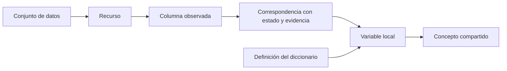

# MEX-Ontologi

**Una ontología para comprender, contextualizar y conectar los datos abiertos de Sonora.**

MEX-Ontologi describe qué información publica el portal de datos abiertos de Sonora, cómo se organiza y qué significan sus variables según la documentación disponible. Reúne publicaciones, archivos, columnas, diccionarios y conceptos en un grafo de conocimiento con vínculos a su evidencia de origen.

Su propósito es facilitar el descubrimiento y la interpretación de los datos, así como evaluar bajo qué condiciones pueden relacionarse distintas fuentes. Cada interpretación conserva su contexto y sus límites: compartir un nombre de columna no basta para establecer una equivalencia ni para autorizar un cruce.

[Qué representa](#qué-representa) · [Qué permite hacer](#qué-permite-hacer) · [Primeros pasos](#primeros-pasos) · [Documentación](#documentación)

## ¿Qué es esta ontología?

Una ontología es un modelo explícito de entidades y relaciones que permite describir un dominio con un vocabulario común. En este proyecto, ese dominio es la información publicada en el portal de datos abiertos de Sonora.

El catálogo permite localizar una publicación; la ontología añade relaciones para interpretar su contenido: quién la publica, qué recursos contiene, cuáles son sus columnas, qué definiciones las documentan y qué conceptos pueden compartir con otras fuentes.

El resultado se representa en **RDF**, un formato de grafo que permite consultar esas relaciones mediante **SPARQL**. Las reglas **SHACL** comprueban restricciones de estructura y coherencia del modelo. El proyecto utiliza Open Ontologies para almacenar y consultar el grafo, y Studio para explorarlo visualmente.

## Qué representa

| Capa | Qué describe |
| --- | --- |
| **Publicaciones** | Conjuntos de datos, recursos, organizaciones publicadoras, temas y páginas del portal. |
| **Estructuras** | Esquemas de archivos y DataStore, hojas y columnas observadas en cada recurso. |
| **Documentación** | Definiciones originales de los diccionarios y sus referencias a unidades o catálogos. |
| **Significados** | Variables locales y conceptos compartidos, conservando el contexto de cada fuente. |
| **Correspondencias** | Vínculos entre columnas físicas y variables documentadas, con estado de revisión y evidencia. |
| **Condiciones de conexión** | Claves, sistemas de códigos, periodos, granularidad y comprobaciones necesarias para evaluar cruces. |
| **Procedencia** | Fuentes, fechas de carga, actividades de extracción y límites de la evidencia recuperada. |

El siguiente esquema resume el recorrido conceptual desde una publicación hasta su significado:



La columna, la definición y el concepto tienen identidades distintas. Esta separación permite describir semejanzas entre fuentes sin perder las diferencias que importan para interpretarlas.

## Qué permite hacer

- **Descubrir información.** Localizar conjuntos, recursos y campos a partir de sus metadatos y relaciones.
- **Consultar significados.** Recuperar la interpretación documentada de una variable y reconocer cuándo falta respaldo suficiente.
- **Rastrear la evidencia.** Seguir las relaciones entre una columna, su diccionario, el recurso y la publicación de origen.
- **Distinguir contextos.** Conservar diferencias entre eventos, poblaciones, unidades, periodos y sistemas de códigos.
- **Evaluar oportunidades de cruce.** Identificar posibles claves comunes y revisar las condiciones pendientes antes de combinar datos.
- **Validar el modelo.** Comprobar reglas estructurales y semánticas mediante SHACL y pruebas automatizadas.
- **Dar contexto a agentes de IA.** Exponer consultas de solo lectura mediante MCP, con reglas explícitas sobre evidencia, estados y alcance.

### Preguntas que ayuda a explorar

- ¿Qué significa una variable según el diccionario de su propio conjunto?
- ¿Qué columnas tienen una correspondencia documental revisada?
- ¿Qué fuentes distinguen municipio de residencia, de registro o de ocurrencia?
- ¿Qué recursos podrían relacionarse y qué comprobaciones faltan?
- ¿Qué información está documentada y qué sigue siendo una hipótesis?

## Criterios de interpretación

La confianza del modelo depende de mantener separadas las afirmaciones documentadas y las propuestas de interpretación.

| Criterio | Cómo se aplica |
| --- | --- |
| **Evidencia trazable** | Toda afirmación sobre datos debe acompañarse de las IRI del conjunto, recurso o columna pertinentes, la URL del diccionario y la fecha de carga. Si falta evidencia, se declara el hueco. |
| **Estados separados** | El estado semántico de una variable es distinto del estado de la correspondencia entre esa variable y una columna. |
| **Hipótesis explícitas** | Una correspondencia `candidata_por_nombre` requiere revisión; la coincidencia nominal no confirma el significado. |
| **Contexto conservado** | Una unidad, un código o una interpretación se atribuyen a la fuente y al ámbito que los respaldan. |
| **Alcance declarado** | Una recuperación parcial se identifica como tal. «No recuperado» no demuestra que algo no exista. |
| **Cruces justificados** | Ni una correspondencia revisada ni una oportunidad detectada autorizan por sí solas una unión de filas. |

La validación SHACL comprueba las reglas expresadas en el modelo; no certifica la exactitud de todos los valores del portal. Las consultas locales reflejan la última carga disponible. La inspección de estructuras tampoco implica que todos los registros de cada archivo estén incorporados al grafo.

## Primeros pasos

### Requisitos

- **Python 3.12**, fijado en `.python-version`.
- **uv** para instalar dependencias y ejecutar los scripts.
- **Open Ontologies** para cargar y consultar el grafo persistente.
- **Studio**, si se desea explorar el grafo mediante su interfaz visual.

No se requiere una base de datos externa. La configuración del portal y la base IRI están en [config.toml](config.toml). La base `https://example.org/mex-ontologi/` es provisional; la decisión sobre su sustitución sigue pendiente.

Desde la carpeta del proyecto:

```powershell
uv sync
```

### Consultar una carga existente

Estos ejemplos requieren que el portal ya esté generado y cargado, con su almacén registrado en `reports/portal-carga.json`.

```powershell
# Consultar el resumen del grafo
uv run python scripts/consultar_ontologia.py resumen

# Buscar significados documentados por nombre de variable
uv run python scripts/consultar_ontologia.py significado --variable anio --limite 20

# Consultar correspondencias y sus estados
uv run python scripts/consultar_ontologia.py correspondencias --variable matrimonios
```

Las oportunidades de cruce se consultan por separado sobre el mapa generado:

```powershell
uv run python scripts/consultar_cruces.py --buscar agricultura --estado candidata_por_validar
uv run python scripts/consultar_cruces.py --buscar titulados --limite 10
```

Para inspeccionar un par concreto, utiliza `--id` con el identificador devuelto por la búsqueda. El resultado incluye perfiles, evidencia y comprobaciones pendientes.

### Acceso para agentes mediante MCP

[opencode.json](opencode.json) configura el servidor local **`mex-ontologia`** en modo persistente. Expone las herramientas `onto_query`, `onto_stats`, `onto_status`, `onto_validate` y `onto_shacl`.

Los agentes deben consultar el grafo mediante este MCP. Si no está disponible, deben utilizar `scripts/consultar_ontologia.py`. Las consultas SPARQL libres son de solo lectura y deben incluir `LIMIT`, con un máximo de 2000 resultados. Los cruces se consultan mediante `scripts/consultar_cruces.py`.

El contrato completo de consulta está en [AGENTS.md](AGENTS.md).

El lanzador y la CLI comparten un único backend persistente por almacén. Los
agentes tienen sesiones MCP independientes y pueden consultar simultáneamente;
ya no abren cada uno su propia instancia de Oxigraph. El backend escucha solo en
localhost, con token local, y ofrece únicamente las cinco herramientas indicadas.
La dirección y el token se guardan en `store/mcp-*.json`, excluidos de Git.

Para verificar la concurrencia:

```powershell
uv run python scripts/comprobar_mcp_concurrente.py
```

La migración requiere reconectar una vez los clientes del lanzador antiguo que
retengan el almacén. No se deben borrar archivos `LOCK`. El backend se conserva
al cerrar un cliente para que los demás continúen; antes de una recarga del store
debe detenerse de forma controlada y sin consultas en curso. El manifiesto de
carga determina qué almacén se comparte, por lo que una nueva instantánea utiliza
un backend distinto.

## Construcción y actualización

El pipeline separa la recuperación del catálogo, la inspección de contenido, la generación del grafo y su sincronización con Studio.

| Etapa | Script | Función |
| --- | --- | --- |
| Explorar | `scripts/explorar_catalogo.py` | Diagnosticar los metadatos publicados sin descargar los archivos de datos. |
| Construir | `scripts/construir_catalogo.py` | Generar el catálogo RDF y, con `--load`, cargarlo en un almacén persistente. |
| Inventariar | `scripts/inventariar_portal.py` | Registrar recursos, páginas, acceso y esquemas DataStore. |
| Inspeccionar | `scripts/inspeccionar_contenido.py` | Recuperar estructuras y diccionarios con evidencia fechada y límites de lectura. |
| Ampliar | `scripts/ampliar_portal.py` | Integrar las capas disponibles, generar RDF y validar con SHACL. |
| Sincronizar | `scripts/sincronizar_studio_portal.py` | Respaldar Studio y actualizar los triples administrados, conservando las demás ediciones. |

La construcción del catálogo base comienza con:

```powershell
uv run python scripts/construir_catalogo.py --load
uv run python scripts/inventariar_portal.py
```

La ampliación semántica depende también de los insumos y evidencias locales de cada etapa. Antes de reconstruir o actualizar el grafo completo, consulta el [modelo del portal](docs/modelo-portal.md), la [guía de contenido y cruces](docs/contenido-y-cruces.md) y el [procedimiento de integración](docs/integracion-de-agentes.md).

Ejecuta cada etapa solo si la anterior terminó correctamente y evita cargas simultáneas. La sincronización requiere Studio abierto. Las descargas de recursos CKAN deben realizarse mediante `scripts/descargar_ckan.py`, que incluye el `User-Agent` requerido por el portal. Los archivos Turtle se generan mediante el pipeline.

## Estructura del repositorio

| Ruta | Contenido |
| --- | --- |
| `ontologia/` | Definiciones y reglas del modelo semántico. |
| `shapes/` | Restricciones de validación SHACL. |
| `scripts/` | Herramientas de extracción, construcción, consulta y verificación. |
| `queries/` | Consultas SPARQL del catálogo y del portal ampliado. |
| `data/` | Insumos, evidencia recuperada y exportaciones generadas. |
| `reports/` | Informes de cobertura, validación, procedencia y resultados. |
| `docs/` | Documentación conceptual y guías operativas. |
| `tests/` | Pruebas automatizadas. |
| `propuestas/` | Entregas de revisión y expedientes de evidencia. |

## Verificación

Para ejecutar la suite de pruebas:

```powershell
uv run python -m unittest discover -s tests -v
```

Para comprobar la conexión con el motor usado por Studio:

```powershell
uv run python scripts/comprobar_studio.py
```

Los recibos de carga y validación se conservan en [portal-carga.json](reports/portal-carga.json). El resultado de sincronización y la referencia al respaldo de Studio están en [studio-portal-sync.json](reports/studio-portal-sync.json).

## Documentación

| Para profundizar en… | Referencia |
| --- | --- |
| Variables, conceptos, estados y evidencia | [Núcleo semántico](docs/nucleo-semantico.md) |
| Catálogo, páginas, recursos y estructuras | [Modelo del portal](docs/modelo-portal.md) |
| Correspondencia entre CKAN y el modelo | [Mapeo del catálogo](docs/mapeo-catalogo.md) |
| Inspección de archivos, diccionarios y cruces | [Contenido y cruces](docs/contenido-y-cruces.md) |
| Condiciones para evaluar pares de fuentes | [Oportunidades de cruce](reports/oportunidades-cruce.md) |
| Cobertura y brechas documentales | [Pendientes semánticos](reports/pendientes-semanticos.md) |
| Instalación y uso de la aplicación visual | [Studio](docs/studio-instalacion.md) |
| Versionado, evidencia y publicación | [Versionado y lanzamientos](docs/versionado-y-lanzamientos.md) |
| Trabajo previsto y condiciones de continuación | [Plan del proyecto](PLAN.md) |

Los informes conservan los resultados y límites de cada ejecución. Sus cifras deben interpretarse con la fecha y el alcance de la evidencia correspondiente.
